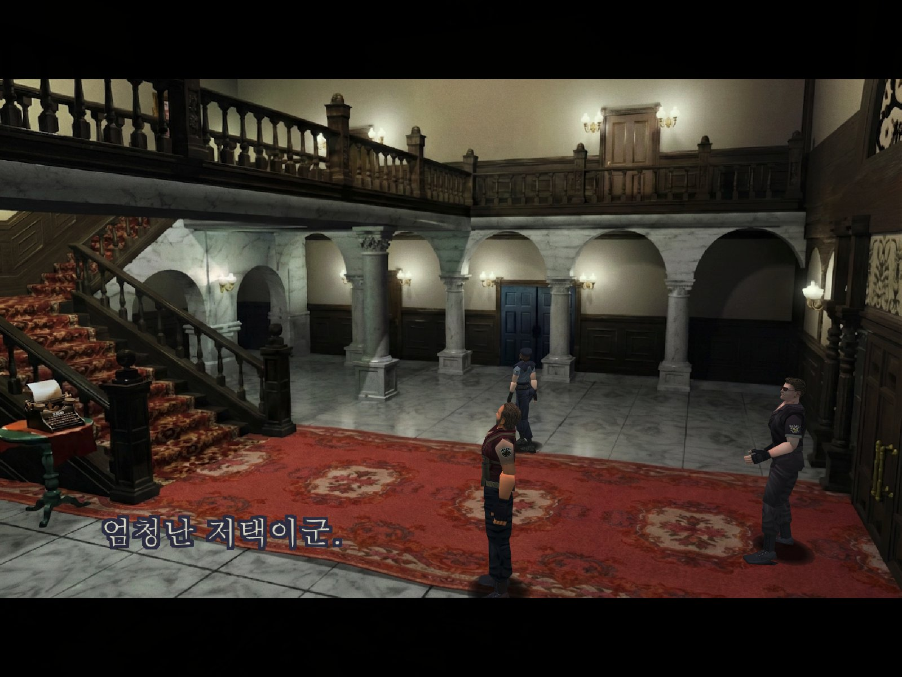
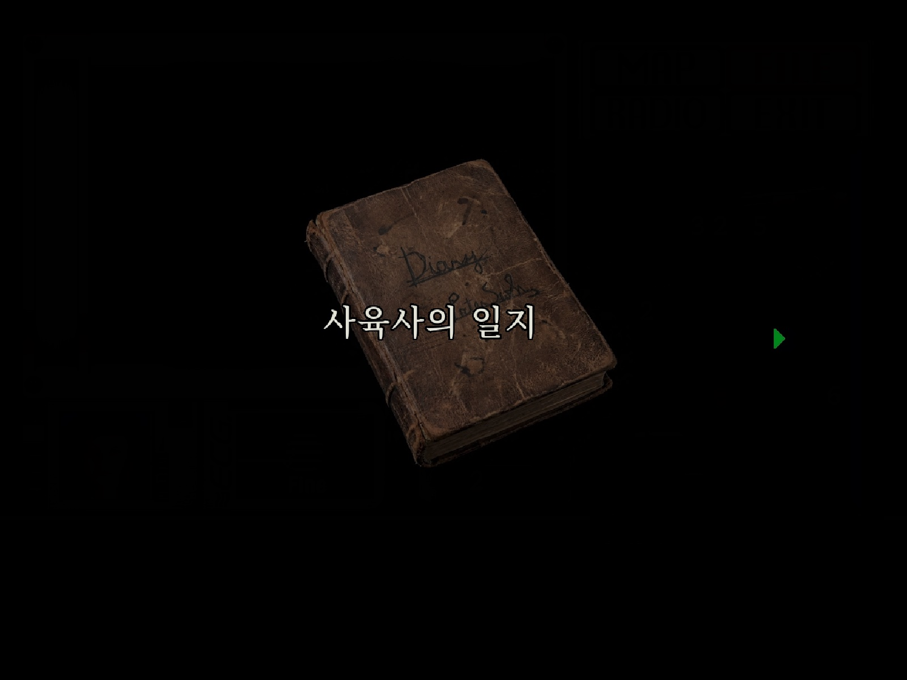
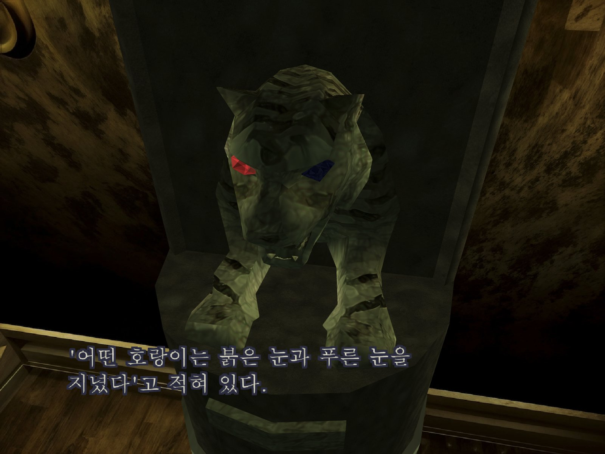
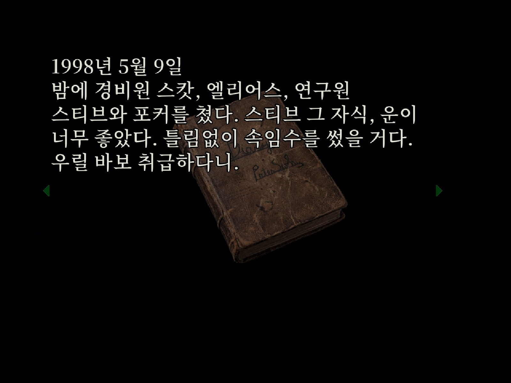
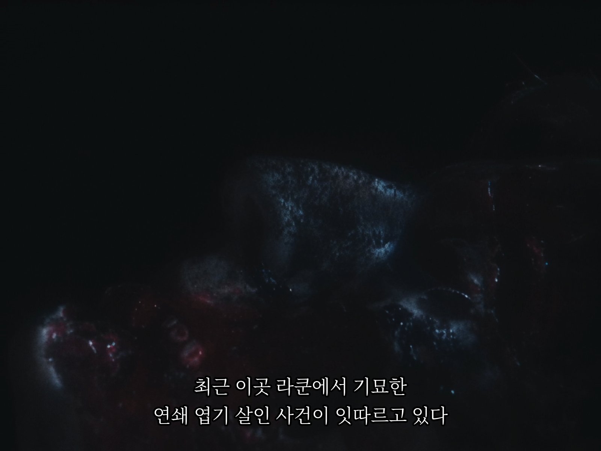
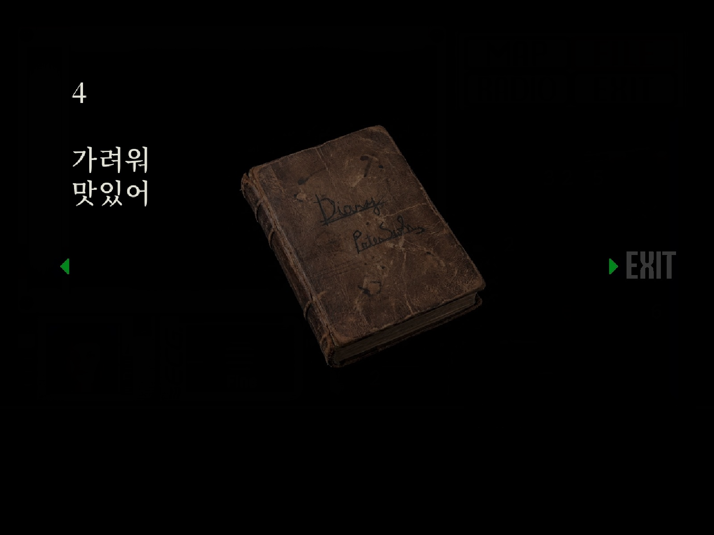
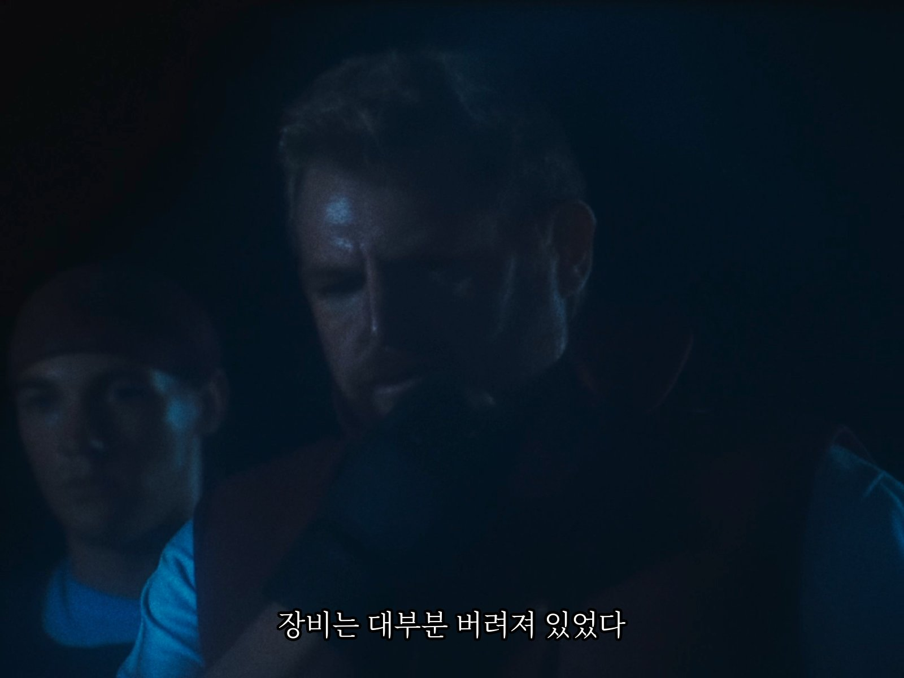
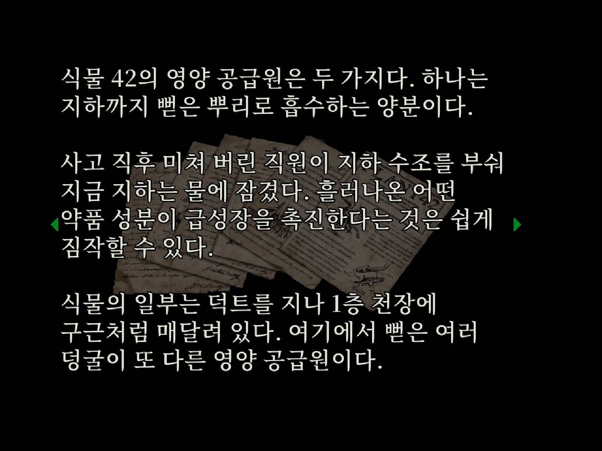
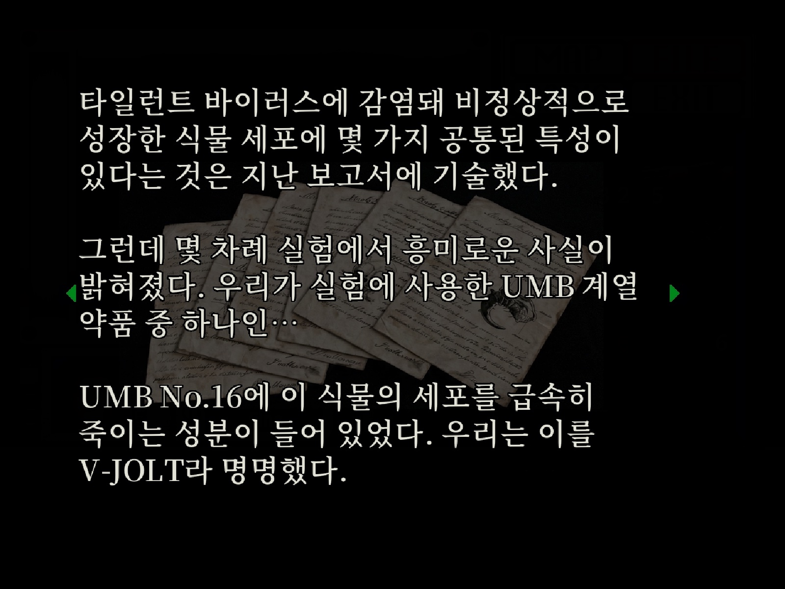

# Resident Evil 한글 HD 번역

원작 Resident Evil(1996) PC판에서 Classic REbirth와 RE:Enhance 환경에 쓰는 비공식 한글 모드입니다. 대사, 메뉴, 아이템, 문서, 영상 자막을 번역했고, 문서는 고해상도로 새로 만들었습니다.

- **지원 게임:** GOG판, Steam판 Resident Evil(1996). 게임은 일본어로 설치해야 합니다.
- **함께 필요한 프로그램:** [Classic REbirth](https://classicrebirth.com/index.php/download/resident-evil-dll-fix-for-classic-edition/) 1.1.4(권장) 또는 1.1.3. 옛 게임을 요즘 Windows에서 실행되게 해 주는 무료 프로그램입니다.
- **모드 이름:** Resident Evil - Korean HD Translation

## 스크린샷

| 게임 화면 | 문서 |
|---|---|
|  |  |
|  |  |
|  |  |
|  |  |
| |  |

함께 쓰면 좋은 모드: [상세 지도: 생존자의 메모](https://github.com/eggu/resident-evil-annotated-map). 지도에 방 이름, 잠긴 문과 필요한 열쇠, 아이템, 퍼즐 위치를 보여 줍니다.

## REbirth 1.1.4와 1.1.3의 차이

두 버전 모두 대사·메뉴·아이템·문서는 한글로 나옵니다. 다른 점은 아래와 같습니다. 특별한 이유가 없다면 1.1.4를 쓰세요.

| | 1.1.4 (권장) | 1.1.3 |
|---|---|---|
| 영상 한글 자막 | 나옴 | **안 나옴** (영상은 원래대로 재생) |
| 대사 글자 크기 | 고화질. `Enable HD loader`를 끄면 원래 크기 | 항상 고화질 |
| 영상 자막 글꼴 바꾸기 | 가능 | 해당 없음 |

## 설치 방법

설치 방법은 두 가지입니다.

- **방법 1:** Classic REbirth만 설치합니다. 원래 게임 화면 그대로 한글로 즐깁니다.
- **방법 2 (추천):** RE:Enhance를 설치한 뒤 REbirth를 1.1.4로 올립니다. 배경 그림과 영상이 고화질로 바뀝니다.

### 시작 전에

1. 필요한 게임은 **1996년 원작 PC판**입니다. `Resident Evil HD REMASTER`는 다른 게임입니다.
   - [GOG 구입 페이지](https://www.gog.com/en/game/resident_evil)
   - [Steam 구입 페이지](https://store.steampowered.com/app/4249100/Resident_Evil_1996/)
2. 게임을 한 번 실행해 잘 켜지는지 확인하고 끕니다.
3. 문제가 생기면 되돌릴 수 있도록 **게임 폴더 전체를 다른 곳에 복사**해 둡니다.
4. 이 안내에서 받는 파일은 모두 ZIP 압축 파일입니다. 오른쪽 클릭 → **모두 압축 풀기**로 풀고, 압축을 푼 폴더 안에서 `Ctrl+A` → `Ctrl+C`, 게임 폴더에서 `Ctrl+V`로 붙여넣습니다. 같은 이름의 파일이 있다고 나오면 **덮어쓰기(바꾸기)**를 고릅니다.

### 1단계. 게임 폴더 찾기

#### GOG

1. 게임 언어를 **일본어(Japanese / 日本語)**로 설치합니다. 이미 다른 언어로 설치했다면 GOG GALAXY에서 게임을 오른쪽 클릭 → **설치 관리** → **설정**에서 언어를 일본어로 바꾸고 다운로드가 끝나길 기다립니다. ([GOG 언어 변경 안내](https://support.gog.com/hc/en-us/articles/360003935197-How-can-I-change-a-GOG-game-s-language))
2. 게임을 오른쪽 클릭 → **설치 관리** → **폴더 표시**를 누릅니다.
3. `Biohazard.exe` 파일과 `jpn` 폴더가 보이면 이곳이 **게임 폴더**입니다.

#### Steam

1. 라이브러리에서 게임을 오른쪽 클릭 → **관리** → **로컬 파일 보기**를 누릅니다. 이곳을 **Steam 루트 폴더**라고 부릅니다.
2. 그 안의 `japanese` 폴더를 엽니다. `Biohazard.exe`와 `jpn` 폴더가 보이면 이 `japanese` 폴더가 **게임 폴더**입니다.

```text
GOG
  게임 폴더/
    Biohazard.exe
    jpn/

Steam
  Steam 루트 폴더/
    4249100_Launcher.exe
    japanese/                 ← 게임 폴더
      Biohazard.exe
      jpn/
```

### 2단계, 방법 1. Classic REbirth만 설치

#### GOG

1. [Biohazard 1.01 패치](https://classicrebirth.com/index.php/download/biohazard-pc-cd-rom-patch-version-1-01/)를 받아 압축을 풀고, 안에 든 `Biohazard.exe`를 게임 폴더에 덮어씁니다.
2. [Classic REbirth 다운로드 페이지](https://classicrebirth.com/index.php/download/resident-evil-dll-fix-for-classic-edition/)에서 **1.1.4 일반 패키지**를 받습니다. (Steam 전용 패키지가 아닙니다.)
3. 압축을 푼 폴더 안의 **내용물 전체**를 게임 폴더에 덮어씁니다. 폴더째 넣지 마세요. `Biohazard.exe` 바로 옆에 `ddraw.dll`이 있으면 맞습니다.
4. [3단계](#3단계-한글패치-설치)로 갑니다.

#### Steam

1. [Classic REbirth 다운로드 페이지](https://classicrebirth.com/index.php/download/resident-evil-dll-fix-for-classic-edition/)에서 **1.1.4 Steam 전용 패키지**를 받습니다.
2. 압축을 풀면 나오는 `4249100_Launcher.exe`와 `japanese` 폴더를 **Steam 루트 폴더**에 덮어씁니다.
3. `japanese` 폴더 안에 `ddraw.dll`이 생겼으면 맞습니다. 폴더 이름이나 파일 위치는 바꾸지 마세요.
4. [3단계](#3단계-한글패치-설치)로 갑니다.

### 2단계, 방법 2. RE:Enhance 설치 후 REbirth 1.1.4로 올리기 (추천)

1. [RE:Enhance v2 GOG 전체 패키지](https://www.moddb.com/downloads/re-enhance-re1-v2-for-gog-version)에서 **Download**를 눌러 `RE-ENHANCE_RE1_v2.0_GOG.zip`(약 2.14GB)을 받습니다. Steam판도 이 파일을 씁니다.
2. 압축을 풀고 `Biohazard.exe`가 보이는 폴더까지 들어가, **내용물 전체**를 게임 폴더에 덮어씁니다.
3. REbirth를 1.1.4로 올립니다.
   - **GOG:** 방법 1의 GOG 2~3번과 같습니다.
   - **Steam:** 방법 1의 Steam 1~3번과 같습니다.
4. 방법 1의 `Biohazard.exe`(1.01 패치)는 넣지 마세요. RE:Enhance에 이미 들어 있습니다.

참고: [RE:Enhance 페이지](https://www.moddb.com/mods/reenhance-re1), [제작자의 Steam 설치 안내](https://www.moddb.com/mods/reenhance-re1/tutorials/reenhance-re1-for-the-steam-version). 이 안내는 제작자 안내와 달리 REbirth 1.1.4 Steam 전용 패키지를 쓰므로 `japanese` 폴더를 그대로 둡니다.

### 3단계. 한글패치 설치

1. [최신 버전 다운로드 페이지](https://github.com/eggu/resident-evil-korean-hd-translation/releases/latest)의 **Assets**에서 `Resident-Evil-Korean-HD-Translation-버전.zip` 파일을 받습니다. 로그인은 필요 없습니다. `Source code`는 받지 마세요.
2. 압축을 풀고 **내용물 전체**를 게임 폴더에 덮어씁니다. 다 넣으면 게임 폴더는 이렇게 됩니다.

```text
게임 폴더/                   ← Biohazard.exe가 있는 곳
  Biohazard.exe
  ddraw.dll                  ← 2단계에서 넣은 REbirth
  korean_subtitle.dll        ← 한글패치
  korean_subtitle.ini
  mod_korean_translation/
  hires/
  jpn/
  movie/
  optional/                  ← 선택 사항 (아래 참고)
```

3. 게임을 실행합니다. GOG는 `Biohazard.exe`, Steam은 라이브러리의 **플레이**를 누릅니다.
4. REbirth 설정 창이 나오면 아래처럼 맞춥니다.
   - **Enable HD loader:** 켜기 (고화질 문서와 그림을 불러오는 기능)
   - **Retro Mode:** 끄기
   - **Enable Japanese:** 끄기
   - **Enable movies:** 켜기
5. **MOD SELECTION** 창에서 **Resident Evil - Korean HD Translation**을 체크하고 시작합니다.
6. 새 게임을 시작해 대사와 문서가 한글로 나오면 설치가 끝난 것입니다.

나중에 RE:Enhance나 REbirth를 다시 덮어썼다면 한글패치도 다시 설치하세요.

#### 선택 사항: 모드 선택 창 건너뛰기

매번 MOD SELECTION에서 체크하기 번거롭다면 `optional` 폴더 안의 `winmm.dll`을 `Biohazard.exe` 옆으로 옮기세요. 다음부터 한글 모드가 자동으로 켜집니다.

- 모드 선택 창이 필요할 때는 **Shift를 누른 채 실행**합니다.
- Mac이나 Linux(Wine, CrossOver, Whisky 등)에서는 `winmm`을 **native, builtin**으로 설정해야 동작합니다.
- 그만 쓰려면 `winmm.dll`을 지우면 됩니다.

### 잘 안 될 때

- **모드 선택 창에 한글 모드가 없어요:** `mod_korean_translation` 폴더가 `Biohazard.exe` 바로 옆에 있는지 확인합니다. 압축을 푼 폴더째 넣었다면 그 안의 내용물을 꺼내 게임 폴더로 옮기세요.
- **문서가 일본어이거나 흐려요:** `Enable HD loader`를 켜고 `Retro Mode`를 끈 뒤 다시 실행합니다.
- **대사가 일본어로 나와요:** MOD SELECTION에서 한글 모드를 체크했는지, `korean_subtitle.dll`과 `mod_korean_translation` 폴더를 모두 복사했는지 확인합니다.
- **영상에 한글 자막이 없어요:** REbirth 1.1.3은 영상 자막을 지원하지 않습니다. 1.1.4로 올려 주세요. [차이점 보기](#rebirth-114와-113의-차이)
- **Steam에서 실행이 안 돼요:** 위 폴더 그림과 파일 위치를 비교해 보세요. 그래도 안 되면 [이슈](https://github.com/eggu/resident-evil-korean-hd-translation/issues)에 REbirth 버전과 오류 내용을 남겨 주세요.

## 영상 자막 글꼴 바꾸기 (REbirth 1.1.4)

게임 폴더의 `korean_subtitle.ini`를 메모장으로 열고 `[MovieSubtitles]`의 `Fonts` 줄을 고칩니다. 글꼴 파일을 세미콜론(`;`)으로 구분해 적으면 앞에서부터 차례로 시도합니다. 기본값은 Windows 바탕체(`batang.ttc`)입니다. 파일 이름만 쓰면 Windows 글꼴 폴더에서 찾습니다. 고친 뒤 게임을 다시 시작하세요. 영상 자막에만 적용되며, 대사와 문서 글꼴은 바뀌지 않습니다.

## 개발자용: 직접 빌드하기

가지고 있는 원본 게임 파일로 배포 ZIP을 만들 수 있습니다. Python 3.12 이상과 아래 원본 파일이 필요합니다. 한글패치를 덮어쓰기 전의 파일이어야 합니다.

```text
원본 게임 폴더/
  ddraw.dll                       # Classic REbirth 1.1.3 또는 1.1.4
  jpn/Data/PBFONT1.TIM
  jpn/Data/EN05.TIM
  jpn/Data/EN07.TIM
  jpn/Item_m2/TEXTM_*.TIM
```

macOS/Linux:

```sh
python3 -m venv .venv
.venv/bin/python -m pip install -r requirements.txt
export RE1_GAME_ORIGINAL_DIR="/path/to/original/Resident Evil"
export RE1_BUILD_FONT="/path/to/korean-font.ttf"   # Linux에서는 필수
.venv/bin/python scripts/package_release.py
```

Windows PowerShell:

```powershell
py -3.12 -m venv .venv
.venv\Scripts\python.exe -m pip install -r requirements.txt
$env:RE1_GAME_ORIGINAL_DIR = 'D:\Games\Resident Evil Original'
$env:RE1_BUILD_FONT = 'C:\Windows\Fonts\batang.ttc'   # 생략하면 바탕
.venv\Scripts\python.exe scripts\package_release.py
```

- 결과물: `dist/Resident-Evil-Korean-HD-Translation-<VERSION>.zip`. 원본 폴더는 읽기만 합니다.
- 지원하지 않는 REbirth 버전이거나 원본 파일 해시가 다르면 빌드를 멈춥니다.
- `RE1_BUILD_FONT`: 대사·메뉴 글꼴(TTF/OTF/TTC, TTC는 첫 번째 글꼴). 기본값은 macOS AppleMyungjo, Windows 바탕.
- `RE1_DOCUMENT_FONT`: 문서 글꼴. 기본값은 저장소의 Noto Serif CJK KR SemiBold(`fonts/`).

### 파일 구성

- `translation/dialogue.csv`, `messages.csv`, `resources.csv`: 번역 원문
- `translation/document-pages.json`: 문서 페이지 배치 (원문과 내용이 같은지 빌드 때 검사)
- `translation/movie_subtitles.json`, `movie_durations.json`: 영상 자막과 시간표
- `translation/layout.json`, `resource_layout.json`: 원문 슬롯·제어 코드 정보
- `source/encoding.xml`: [RE1 Mod SDK](https://github.com/Gemini-Loboto3/RE1-Mod-SDK)의 문자 매핑
- `build_*.py`: 대사·문서·영상 자막 생성기
- `src/`: 게임에 들어가는 렌더러 DLL 소스
- `scripts/package_release.py`: 전체 빌드와 ZIP 패키징

## 라이선스

소스 코드와 번역 CSV는 [MIT License](LICENSE)입니다. Capcom 및 Classic REbirth와 관련 없는 비공식 팬 번역입니다. Resident Evil / Biohazard와 원본 게임 파일의 권리는 Capcom에 있으며, 이 저장소와 배포 ZIP에는 원본 게임 파일이 들어 있지 않습니다.
